# Vite & Gourmand — Maquettes (wireframes et mockups)

> Document **modifiable** : chaque écran a sa fiche (accès, zones, contenus, champs, actions). Modifiez le texte librement ; les images sont dans `wireframes/` et `mockups/`, et les PDF complets sont `wireframes.pdf` et `mockups.pdf`.

**Formats** : iPhone 14 (390 px de large) et MacBook Air 13" (1280 px de large).

**Charte** : couleur principale bordeaux `#8B1E2D`, fond clair `#F8F9FA`, texte `#212529` ; police système (Segoe UI, Roboto, Helvetica, Arial) ; boutons arrondis ; cartes à coins arrondis et ombre légère ; Bootstrap 5.3.

**Éléments communs à tous les écrans**

- **En-tête** : logo « Vite & Gourmand », menu (Accueil, Menus, Contact, puis Connexion / Créer un compte, ou Commander / Mes commandes / Mon compte une fois connecté), bouton « Accessibilité ». Sur mobile, le menu passe dans un bouton burger.
- **Pied de page** (bordeaux) : présentation, horaires d'ouverture, liens (menus, contact, mentions légales, CGV, confidentialité, devis), boutons « Espace client » et « Espace admin ».
- **Responsive** : sur mobile, les colonnes s'empilent, les tableaux deviennent des cartes, la barre de l'espace équipe défile horizontalement.

## Sommaire

1. [Accueil](#01-accueil)
2. [Menus](#02-menus)
3. [Détail menu](#03-detail-menu)
4. [Inscription](#04-inscription)
5. [Connexion](#05-connexion)
6. [Contact](#06-contact)
7. [Commander](#07-commander)
8. [Confirmation](#08-confirmation)
9. [Mes commandes](#09-mes-commandes)
10. [Profil](#10-profil)
11. [Admin - Tableau de bord](#11-admin-tableau-de-bord)
12. [Admin - Commandes](#12-admin-commandes)

---

## 01 Accueil

- **URL** : `/`
- **Accès** : Tout visiteur

### Zones de l'écran (de haut en bas)

1. **Des réceptions soignées, un choix clair, une commande simple.**
   - Texte : Mariages, cocktails, repas d'entreprise, anniversaires ou déjeuners d'équipe : des formules adaptées, du service sur place à la livraison.
   - Cartes : 1
   - Actions : [Découvrir les menus] [Se connecter] [Demander un devis]
2. **Pourquoi nous choisir ?**
3. **Julie et José, 25 ans de métier à Bordeaux**
   - Texte : Depuis 25 ans, Vite & Gourmand accompagne les Bordelais pour leurs repas de fête, de Noël à Pâques, et pour tous leurs évènements, avec des menus qui évoluent au fil des saisons.
   - Sous-titres : Julie · José
   - Cartes : 3
4. **Une grande réception ou un événement sur devis ?**
   - Actions : [Demander un devis]
5. **Menus à la une**
   - Texte : Les formules disponibles actuellement.
   - Sous-titres : Formule Enfant · Formule Bistrot · Formule Végétale
   - Cartes : 3
   - Images : 3
   - Actions : [Tout voir] [Voir le détail] [Se connecter pour commander]
6. **Avis clients**
   - Texte : Quelques retours après des prestations.
   - Cartes : 3

### Notes de conception

- _À compléter : intentions, règles métier, évolutions prévues._

### Aperçus

| Wireframe iPhone 14 | Mockup iPhone 14 |
|---|---|
|  |  |

**Wireframe MacBook Air 13"**

**Mockup MacBook Air 13"**

---

## 02 Menus

- **URL** : `/menus?people=8`
- **Accès** : Tout visiteur

### Zones de l'écran (de haut en bas)

1. **Nos menus**
   - Texte : Un prix par personne, tout compris : apéritif, entrée, plat, accompagnements, dessert et digestif.
   - Sous-titres : Formule Enfant · Formule Bistrot · Formule Végétale · Menu Familial · Menu Convivial · Menu Végétarien du Marché · Menu Végétal Élégance · Menu Marée de Printemps
   - Cartes : 10
   - Images : 10
   - Champs : Pour combien de personnes ? (number) ; Tous (radio) ; Noël (radio) ; Pâques (radio) ; Classique (radio) ; Évènement (radio) ; Classique (checkbox) ; Végétarien (checkbox) ; Végan (checkbox) ; Minimum (€ / pers.) (number) ; Maximum (€ / pers.) (number)
   - Actions : [−] [+] [1] [2] [4] [6] [10] [15] [20] [Appliquer] [Tout effacer] [Se connecter pour commander]

### Notes de conception

- _À compléter : intentions, règles métier, évolutions prévues._

### Aperçus

| Wireframe iPhone 14 | Mockup iPhone 14 |
|---|---|
|  |  |

**Wireframe MacBook Air 13"**

**Mockup MacBook Air 13"**

---

## 03 Détail menu

- **URL** : `/menus/10?people=8`
- **Accès** : Tout visiteur

### Zones de l'écran (de haut en bas)

1. **Menu de Noël**
   - Texte : 36,90 € par personne · à partir de 4 personnes
   - Cartes : 1
   - Images : 1
   - Actions : [Image précédente] [Image suivante]
2. **Menu de Noël**
   - Sous-titres : Inclus pour chaque convive · 1 apéritif au choix parmi 2 · 1 entrée · 1 plat · 2 accompagnements · 1 dessert · 1 digestif au choix parmi 2 · Conditions de commande
   - Champs : Nombre de personnes (number)
   - Actions : [−] [+] [Se connecter pour commander] [Créer un compte] [Retour aux menus]

### Notes de conception

- _À compléter : intentions, règles métier, évolutions prévues._

### Aperçus

| Wireframe iPhone 14 | Mockup iPhone 14 |
|---|---|
|  |  |

**Wireframe MacBook Air 13"**

**Mockup MacBook Air 13"**

---

## 04 Inscription

- **URL** : `/register`
- **Accès** : Visiteur non connecté

### Zones de l'écran (de haut en bas)

1. **Créer votre compte**
   - Champs : Prénom (text, obligatoire) ; Nom (text, obligatoire) ; Téléphone (tel, obligatoire) ; Adresse email (email, obligatoire) ; Adresse postale (textarea, obligatoire) ; Me proposer un mot de passe aléatoire sécurisé (checkbox) ; Mot de passe (password, obligatoire) ; Confirmation (password, obligatoire) ; J’ai lu la politique de confidentialité et j’accepte les conditions générales de vente. (checkbox, obligatoire)
   - Actions : [Afficher] [Générer un autre] [Copier] [Créer mon compte]

### Notes de conception

- _À compléter : intentions, règles métier, évolutions prévues._

### Aperçus

| Wireframe iPhone 14 | Mockup iPhone 14 |
|---|---|
|  |  |

**Wireframe MacBook Air 13"**

**Mockup MacBook Air 13"**

---

## 05 Connexion

- **URL** : `/login`
- **Accès** : Visiteur non connecté

### Zones de l'écran (de haut en bas)

1. **Connexion**
   - Champs : Adresse email (email, obligatoire) ; Mot de passe (password, obligatoire)
   - Actions : [Afficher] [Se connecter]

### Notes de conception

- _À compléter : intentions, règles métier, évolutions prévues._

### Aperçus

| Wireframe iPhone 14 | Mockup iPhone 14 |
|---|---|
|  |  |

**Wireframe MacBook Air 13"**

**Mockup MacBook Air 13"**

---

## 06 Contact

- **URL** : `/contact`
- **Accès** : Tout visiteur

### Zones de l'écran (de haut en bas)

1. **Contact**
   - Champs : Titre (text, obligatoire) ; Email (email, obligatoire) ; Description (textarea, obligatoire)
   - Actions : [Envoyer]

### Notes de conception

- _À compléter : intentions, règles métier, évolutions prévues._

### Aperçus

| Wireframe iPhone 14 | Mockup iPhone 14 |
|---|---|
|  |  |

**Wireframe MacBook Air 13"**

**Mockup MacBook Air 13"**

---

## 07 Commander

- **URL** : `/orders/new?menu=10&people=8`
- **Accès** : Client connecté

### Zones de l'écran (de haut en bas)

1. **Votre commande**
   - Texte : Indiquez combien vous serez : nous vous montrons tout de suite les menus possibles et leur prix total.
   - Cartes : 1
2. **1. Nombre de personnes et menu**
   - Cartes : 1
   - Champs : Combien de personnes ? (number, obligatoire) ; Formule Enfant12,90 € / pers. · dès 1 pers.92,88 €−10 %8 × 12,90 € (radio, obligatoire) ; Formule Bistrot18,90 € / pers. · dès 1 pers.136,08 €−10 %8 × 18,90 € (radio, obligatoire) ; Formule Végétale19,90 € / pers. · dès 1 pers.143,28 €−10 %8 × 19,90 € (radio, obligatoire) ; Menu Familial20,90 € / pers. · dès 3 pers.150,48 €−10 %8 × 20,90 € (radio, obligatoire) ; Menu Convivial21,90 € / pers. · dès 2 pers.157,68 €−10 %8 × 21,90 € (radio, obligatoire) ; Menu Végétarien du Marché22,90 € / pers. · dès 3 pers.164,88 €−10 %8 × 22,90 € (radio, obligatoire) ; Menu Végétal Élégance25,90 € / pers. · dès 2 pers.186,48 €−10 %8 × 25,90 € (radio, obligatoire) ; Menu Marée de Printemps28,90 € / pers. · dès 2 pers.208,08 €−10 %8 × 28,90 € (radio, obligatoire) ; Menu Réception Signature34,90 € / pers. · dès 6 pers.279,20 €8 × 34,90 € (radio, obligatoire) ; Menu de Noël36,90 € / pers. · dès 4 pers.295,20 €8 × 36,90 € (radio, obligatoire)
   - Actions : [−] [+] [1] [2] [4] [6] [10] [15] [20]
3. **2. Composez votre menu**
   - Cartes : 1
   - Champs : Plat (select) ;  (number) ; sans gluten (checkbox) ; sans poisson (checkbox) ; Plat (select) ;  (number) ; sans gluten (checkbox) ; sans lait (checkbox) ; sans œufs (checkbox) ; Plat (select) ;  (number) ; sans gluten (checkbox) ; Plat (select) ;  (number) ; Plat (select) ;  (number) ; sans lait (checkbox) ; Plat (select) ;  (number) ; Plat (select) ;  (number) ; sans lait (checkbox) ; sans œufs (checkbox) ; Plat (select) ;  (number) ; sans lait (checkbox) ; Plat (select) ;  (number) ; Allergies ou précisions pour la cuisine (facultatif) (textarea) ; J’accepte que ces informations de santé (allergies, plats sans allergène) soient utilisées pour préparer ma commande. En savoir plus (checkbox)
   - Actions : [−] [+] [+ variante pour quelques convives]
4. **3. Livraison, retrait ou sur place**
   - Cartes : 1
   - Champs : Livraison Offerte dans Bordeaux, 5 € + 0,59 €/km jusqu’à 25 km. Au-delà, sur acceptation. (radio) ; À emporter Gratuit, à notre adresse à Bordeaux. (radio) ; Sur place Gratuit, repas servi chez nous. (radio) ; Adresse de livraison (numéro et rue) (text, obligatoire) ; Code postal (text, obligatoire) ; Ville (text, obligatoire) ; Instructions pour le livreur (facultatif : bâtiment, étage, digicode) (textarea)
5. **4. Date et heure**
   - Cartes : 1
   - Champs : Date (date, obligatoire) ; Heure (select, obligatoire)
6. **5. Contact**
   - Cartes : 1
   - Champs : Téléphone le jour de la prestation (tel, obligatoire)
7. **Récapitulatif**
   - Actions : [Valider la commande] [Retour aux menus]

### Notes de conception

- _À compléter : intentions, règles métier, évolutions prévues._

### Aperçus

| Wireframe iPhone 14 | Mockup iPhone 14 |
|---|---|
|  |  |

**Wireframe MacBook Air 13"**

**Mockup MacBook Air 13"**

---

## 08 Confirmation

- **URL** : `/orders/confirmation/1009`
- **Accès** : Client connecté

### Zones de l'écran (de haut en bas)

1. **Commande envoyée !**
   - Actions : [Suivre mes commandes] [Retour aux menus]

### Notes de conception

- _À compléter : intentions, règles métier, évolutions prévues._

### Aperçus

| Wireframe iPhone 14 | Mockup iPhone 14 |
|---|---|
| 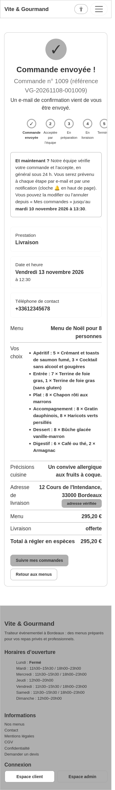 | 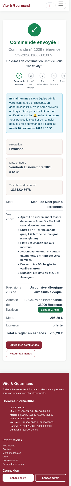 |

**Wireframe MacBook Air 13"**

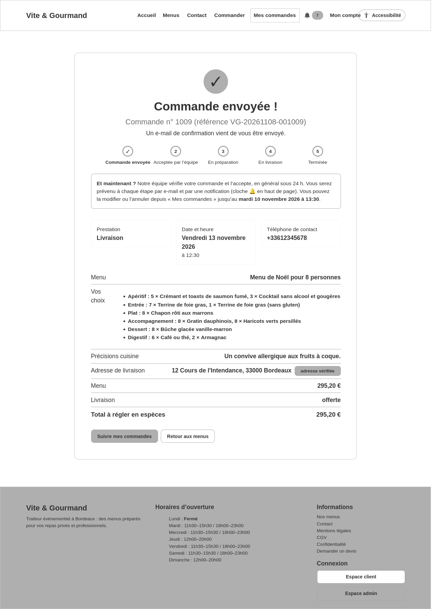

**Mockup MacBook Air 13"**

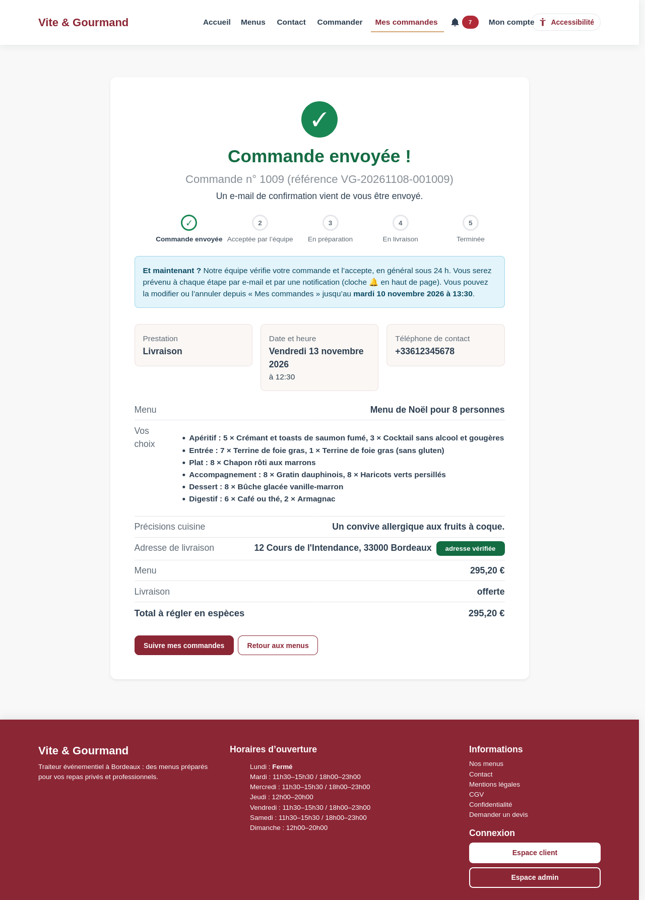

---

## 09 Mes commandes

- **URL** : `/orders`
- **Accès** : Client connecté

### Zones de l'écran (de haut en bas)

1. **Mes commandes**
   - Texte : Suivez vos prestations, leurs statuts et leurs dates.
   - Cartes : 1
   - Actions : [Nouvelle commande]
2. **Commande … (bloc répété ×4, un par élément)**
   - Sous-titres : Suivi · Choix dans le menu
   - Cartes : 1
   - Champs : Personnes (number, obligatoire) ; Date (date, obligatoire) ; Créneau (select, obligatoire) ; Téléphone (tel, obligatoire) ; Livraison (radio) ; À emporter (radio) ; Sur place (radio) ; Adresse (text, obligatoire) ; Code postal (text, obligatoire) ; Ville (text, obligatoire) ; Adresse introuvable sur la carte mais correcte (saisie manuelle) (checkbox) ; Accepter la livraison hors zone (plus de 25 km), au tarif kilométrique (checkbox) ; Instructions pour le livreur (facultatif) (textarea) ; Plat (select) ;  (number) ; sans gluten (checkbox) ; sans poisson (checkbox) ; Plat (select) ;  (number) ; sans gluten (checkbox) ; sans lait (checkbox) ; sans œufs (checkbox) ; Plat (select) ;  (number) ; sans gluten (checkbox) ; Plat (select) ;  (number) ; sans gluten (checkbox) ; Plat (select) ;  (number) ; Plat (select) ;  (number) ; sans lait (checkbox) ; Plat (select) ;  (number) ; Plat (select) ;  (number) ; sans lait (checkbox) ; sans œufs (checkbox) ; Plat (select) ;  (number) ; sans lait (checkbox) ; Plat (select) ;  (number) ; Allergies ou précisions pour la cuisine (facultatif) (textarea) ; J’accepte que ces informations de santé (allergies, plats sans allergène) soient utilisées pour préparer ma commande. (checkbox)
   - Actions : [−] [+] [+ variante pour quelques convives] [retirer] [Enregistrer les modifications] [Annuler la commande]
3. **Commande … (bloc répété ×5, un par élément)**
   - Sous-titres : Suivi
   - Cartes : 1

### Notes de conception

- _À compléter : intentions, règles métier, évolutions prévues._

### Aperçus

| Wireframe iPhone 14 | Mockup iPhone 14 |
|---|---|
|  |  |

**Wireframe MacBook Air 13"**

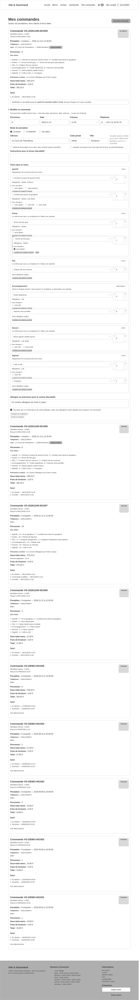

**Mockup MacBook Air 13"**

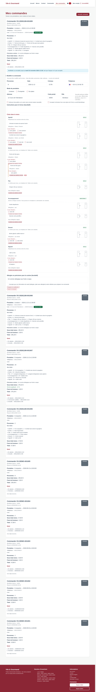

---

## 10 Profil

- **URL** : `/profile`
- **Accès** : Client connecté

### Zones de l'écran (de haut en bas)

1. **Mon profil**
   - Cartes : 1
   - Champs : Prénom (text, obligatoire) ; Nom (text, obligatoire) ; Email (email, obligatoire) ; Téléphone (tel, obligatoire) ; GSM (tel, obligatoire) ; Adresse (textarea, obligatoire)
   - Actions : [Enregistrer]
2. **Changer mon mot de passe**
   - Cartes : 1
   - Champs : Mot de passe actuel (password, obligatoire) ; Nouveau mot de passe (password, obligatoire) ; Confirmation (password, obligatoire)
   - Actions : [Afficher] [Modifier le mot de passe]
3. **Mes données personnelles**
   - Champs : Mot de passe actuel (password, obligatoire) ; Je comprends que la suppression est définitive. (checkbox, obligatoire)
   - Actions : [Télécharger mes données (JSON)] [Afficher] [Supprimer mon compte]

### Notes de conception

- _À compléter : intentions, règles métier, évolutions prévues._

### Aperçus

| Wireframe iPhone 14 | Mockup iPhone 14 |
|---|---|
| 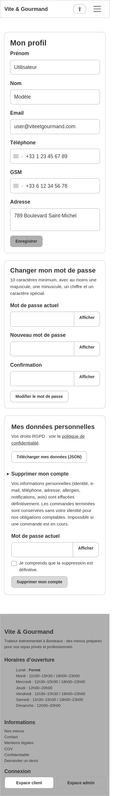 | 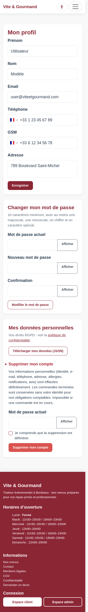 |

**Wireframe MacBook Air 13"**

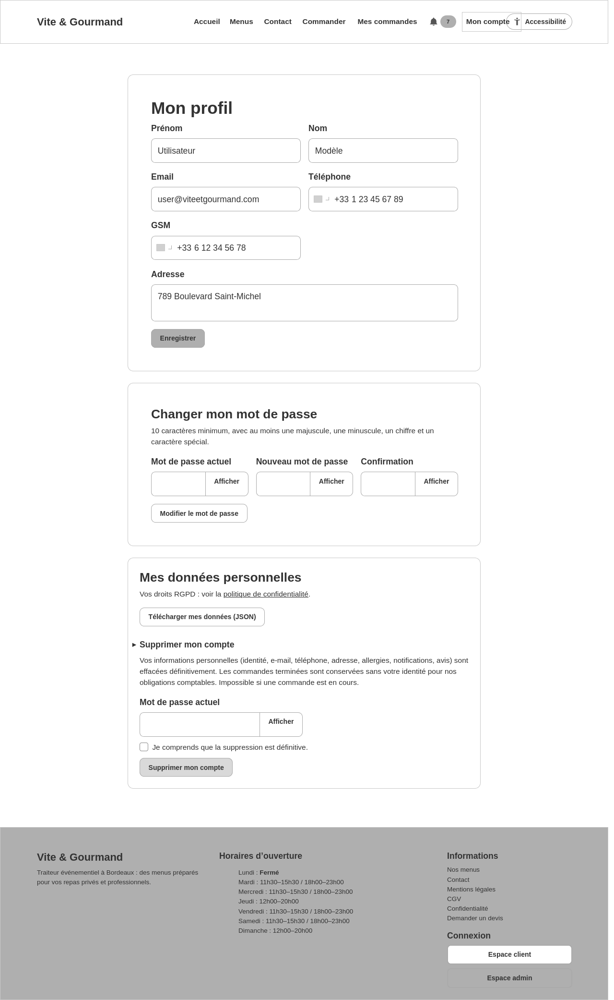

**Mockup MacBook Air 13"**

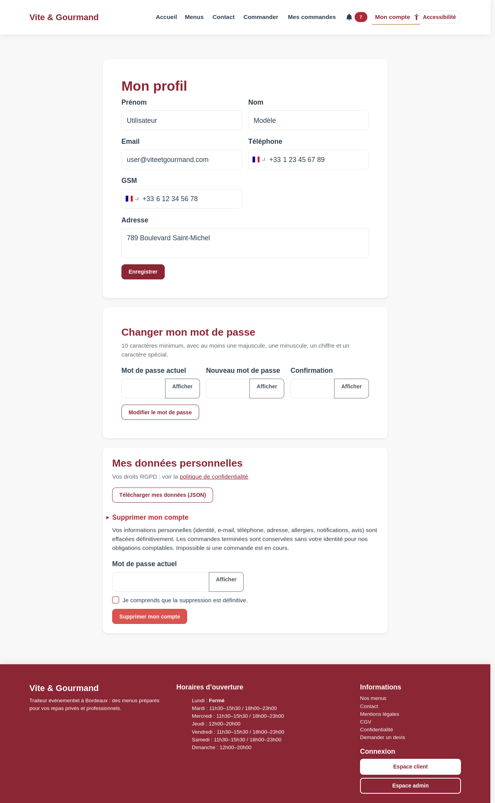

---

## 11 Admin - Tableau de bord

- **URL** : `/admin/dashboard`
- **Accès** : Administrateur

### Zones de l'écran (de haut en bas)

1. **Tableau de bord**
   - Cartes : 5
2. **Comparaison graphique des commandes par menu**

### Notes de conception

- _À compléter : intentions, règles métier, évolutions prévues._

### Aperçus

| Wireframe iPhone 14 | Mockup iPhone 14 |
|---|---|
| 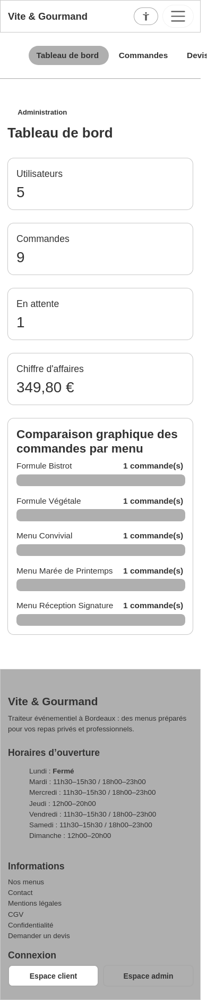 | 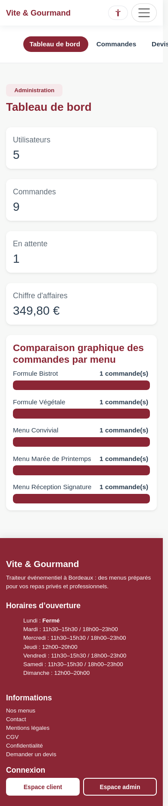 |

**Wireframe MacBook Air 13"**

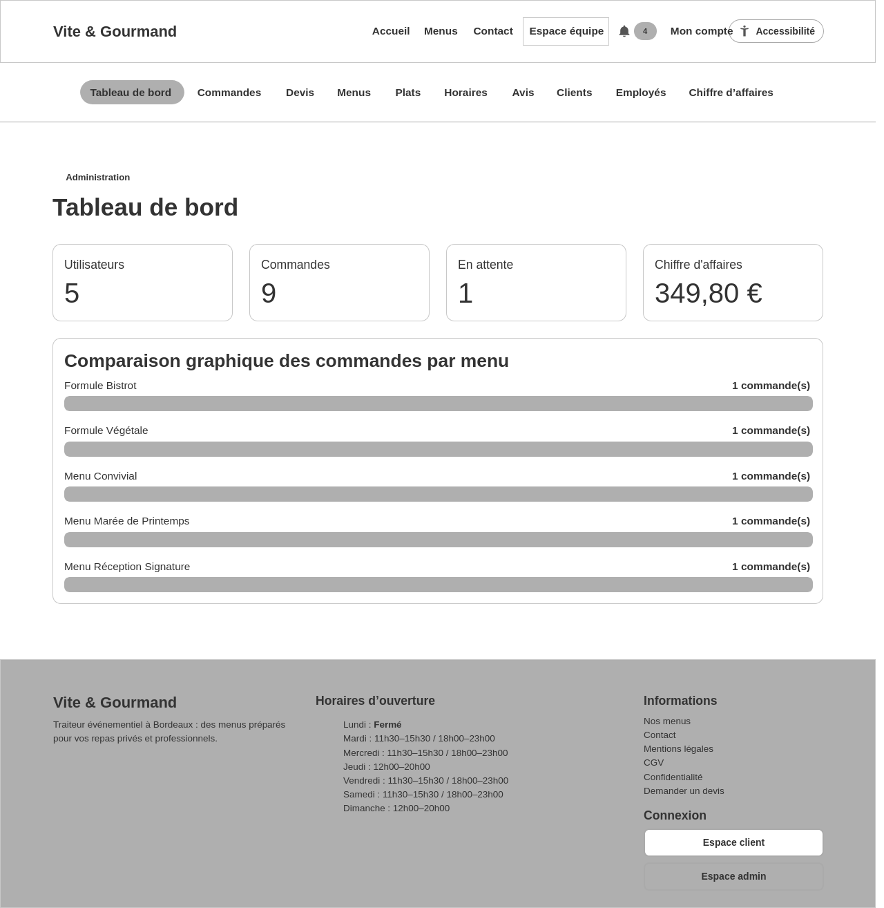

**Mockup MacBook Air 13"**

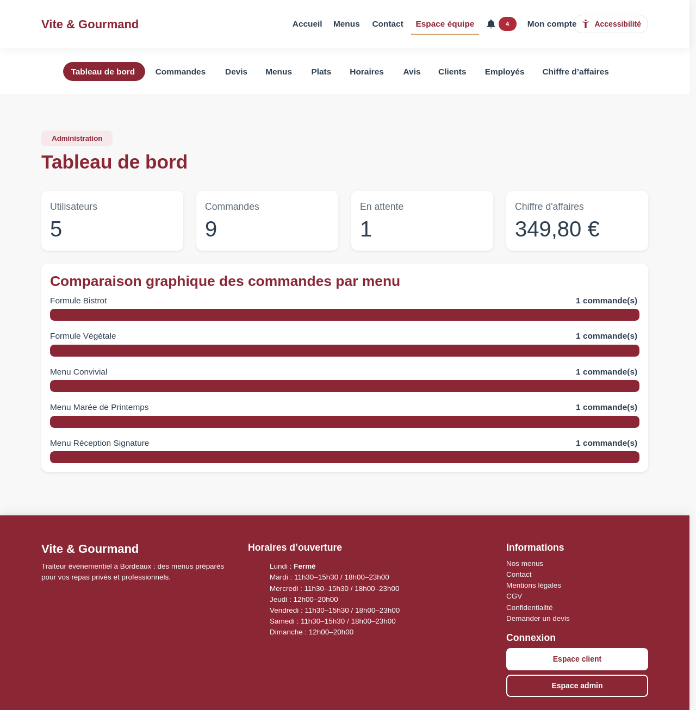

---

## 12 Admin - Commandes

- **URL** : `/admin/orders`
- **Accès** : Employé ou administrateur

### Zones de l'écran (de haut en bas)

1. **Gestion des commandes**
   - Texte : Suivi des commandes clients et des transitions de prestation.
   - Cartes : 2
   - Champs : Client (text) ; Statut (select)
   - Actions : [Filtrer]
2. **Commande … (bloc répété ×5, un par élément)**
   - Cartes : 1
3. **Commande … (bloc répété ×4, un par élément)**
   - Cartes : 1

### Notes de conception

- _À compléter : intentions, règles métier, évolutions prévues._

### Aperçus

| Wireframe iPhone 14 | Mockup iPhone 14 |
|---|---|
|  |  |

**Wireframe MacBook Air 13"**

**Mockup MacBook Air 13"**

